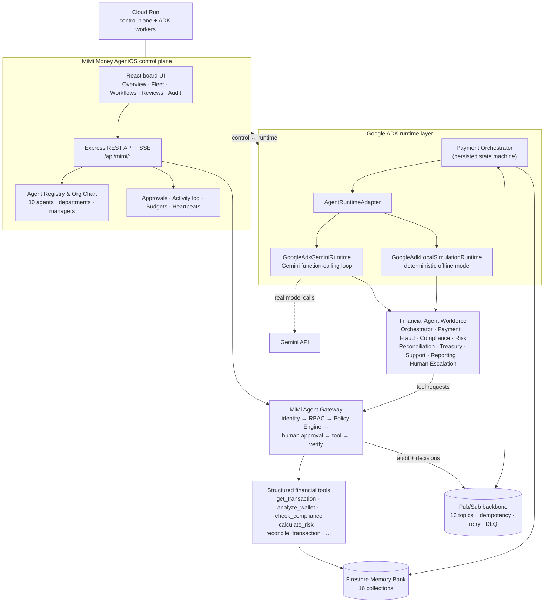
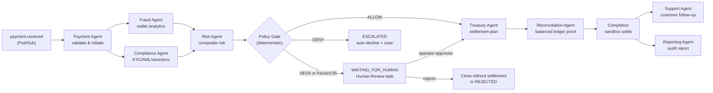
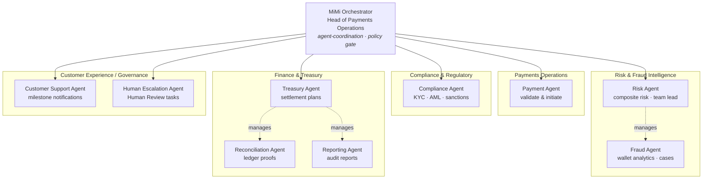
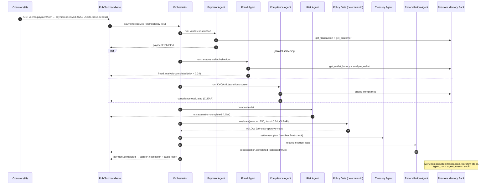
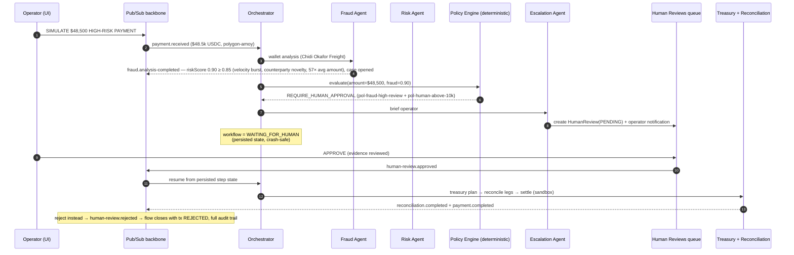

# MiMi AgentOS — Architecture

> **MiMi Money AgentOS — African Financial AI Workforce** · *Fortified Enterprise Fleet* track
>
> **DEMO / SANDBOX MODE — all financial operations are simulated. No real funds are ever moved.**

MiMi AgentOS turns an AI-agent control plane into an **enterprise financial AI workforce**: ten specialized agents that validate payments, hunt fraud, enforce compliance, price risk, plan settlement, reconcile ledgers, brief customers, write audit reports — and know exactly when to stop and ask a human.

It is built **on top of Paperclip** (MIT-licensed open-source orchestration for teams of AI agents), which supplies the proven enterprise control plane: org charts for agents, approvals/human-in-the-loop, activity logging & governance, budgets with hard stops, heartbeats, tasks/goals, RBAC and company scoping. Paperclip's existing capabilities are preserved and reused; MiMi extends them into the financial domain rather than replacing them.

---

## 1. The stack in one line each

| Layer | Technology | Role |
|---|---|---|
| **Enterprise AI control plane** | **MiMi Money AgentOS** | Org chart, agent registry, approvals, budgets, activity/governance, UI shell, REST surface; implemented on the Paperclip framework |
| **Intelligence / model layer** | **Multimodal Google Gemini** (`gemini-3.6-flash` mission-critical; `gemini-3.5-flash` lightweight) | Text/image/audio/video understanding, planning, reasoning and tool selection inside every ADK agent |
| **Agent framework / runtime** | **Google ADK semantics** via `AgentRuntimeAdapter` | Sessions, runs, tool loops, pause/resume/cancel/inspect lifecycle |
| **Identity / authorization / policy gateway** | **MiMi Agent Gateway** | Agent identity → RBAC → deterministic Policy Engine → human approval → authorized tool → verification → event → persistence → audit |
| **Asynchronous event backbone** | **Google Pub/Sub** (emulator-compatible; in-process transport when unconfigured) | Every domain event between agents, with idempotency, retries, DLQ |
| **Persistent Memory Bank / state store** | **Google Firestore** (emulator-compatible; embedded store fallback) | Agents, customers, transactions, workflows, runs, events, policies, reviews, audit |
| **Deployment / runtime infra** | **Cloud Run** | One minimal service hosts control plane + ADK workers; scale-to-zero keeps cost near zero |

No GKE, no Cloud SQL, no always-on services. The whole production footprint is Cloud Run + three managed primitives — deliberately near-zero-cost for a hackathon.

---

## 2. System architecture



**Key rule:** Gemini proposes; the Gateway disposes. LLM output never executes a privileged financial action directly. A model can only emit a `functionCall` request, which must pass the full Gateway pipeline before any tool executes.

---

## 3. The Gateway pipeline (every sensitive action)

```
Agent identity → RBAC/capability check → deterministic Policy Engine
   → human approval (when required) → authorized tool → result verification
   → Pub/Sub event → Firestore persistence → audit record
```

Implemented once in `packages/mimi/src/gateway.ts`. Denials, executions and approval requirements are ALL audited. Rate limits are enforced per `(agent, tool)` per minute. Budgets hard-stop paused agents at their monthly cap (inherited from Paperclip's budget governance concept).

## 4. Deterministic Policy Engine

`packages/mimi/src/policy-engine.ts` evaluates an ordered seeded rule set (`policies` collection):

| Rule | Effect |
|---|---|
| Sandbox assets/networks only | DENY anything referencing real-money rails |
| Fraud risk ≥ 0.97 | DENY (auto-decline) + case |
| Sanctions / hard AML hit | DENY + freeze follow-ups |
| Amount ≥ $10,000 | REQUIRE_HUMAN_APPROVAL |
| Fraud risk ≥ 0.85 | REQUIRE_HUMAN_APPROVAL |
| Amount < $1,000 ∧ risk < 0.40 ∧ clear | ALLOW autonomous completion |
| Tool rate limits (default 60/min) | DENY excess calls |
| Budget cap reached | DENY until reset |

Same inputs ⇒ same decision, every time — fully explainable to a regulator or judge.

## 5. Payment workflow (the demo graph)



- State transitions persist in `workflows` / `workflow_steps` collections; every transition publishes to the backbone.
- Step statuses: IDLE · QUEUED · RUNNING · WAITING · COMPLETED · FAILED (+ workflow ESCALATED).
- Timeouts, bounded retries with backoff, dead-letter queue, and startup **recovery from persisted state** (`recoverInFlight`) make the machine crash-safe.
- Duplicate `payment.received` events are suppressed by idempotency key at both bus and workflow level.
- Meaningful milestones are mirrored into the host control-plane activity log; Human Reviews appear as MiMi Money AgentOS operator tasks with Approve/Reject.

### The two demo flows

| Flow | Path through policy | Outcome |
|---|---|---|
| **SIMULATE $250 LOW-RISK PAYMENT** (customer: Amara Okonkwo, Lagos) | fraud ≈ 0.24 → `pol-auto-approve-max` matches | COMPLETED autonomously in seconds |
| **SIMULATE $48,500 HIGH-RISK PAYMENT** (customer: Chidi Okafor Freight, Kano) | wallet analysis scores 0.90 (velocity, novelty, 57× average amount) → `pol-fraud-high-review` + `pol-human-above-10k` | WAITING_FOR_HUMAN → review created → approve → resumes → COMPLETED (or reject → REJECTED) |

## 6. Google ADK runtime

Three interchangeable implementations sit behind one `AgentRuntimeAdapter` contract (create / start / inspect / pause / resume / cancel runs; session event logs; tool loops):

| Adapter | File | Execution |
|---|---|---|
| `GoogleAdkGeminiRuntime` | `packages/mimi/src/adk-gemini-runtime.ts` | Real Gemini function-calling loop per agent over the Gemini REST API |
| `GoogleAdkLocalSimulationRuntime` | `packages/mimi/src/adk-local-runtime.ts` | Deterministic local execution of the same contract (zero-dependency dev/CI/offline demos) |
| `GoogleAdkRemoteRuntime` | `packages/mimi/src/adk-remote-runtime.ts` | Delegates to **real `google-adk` Python agents** (`services/mimi-adk-runtime`) on Cloud Run |

- Each agent = instruction-tuned system prompt + only its Gateway-approved tool declarations (Gemini function calling).
- Session event log per run (`agent_runs`): user message → model tool calls → tool responses → final text. **Chain-of-thought is never requested nor persisted** — only conclusions, tool calls and results.
- Iteration budget, timeouts, token/cost accounting feeding agent budgets.
- The Python ADK service (`services/mimi-adk-runtime`) hosts genuine `google.adk.agents.LlmAgent`s whose tools call privileged capability BACK through the Gateway HTTP surface (`POST /api/mimi/gateway/tool-call`) — identity, RBAC, policy and audit are identical no matter which adapter reasoned.
- Selection: set `MIMI_ADK_RUNTIME_URL` → remote google-adk service; else `MIMI_GEMINI_API_KEY` → Gemini mode; otherwise local simulation. Force with `MIMI_ADK_MODE=google|local|remote`.

## 7. Event backbone

Topics (`mimi.*`): transactions, payments, fraud, compliance, risk, reconciliation, treasury, support, reporting, lifecycle, human-review, audit, notifications.

Envelope: `{eventId, topic, type, workflowId, correlationId, idempotencyKey, occurredAt, sourceAgent, targetAgent, payload, attempt}`.

Guarantees implemented in `MimiEventBus`: duplicate suppression by idempotency key, at-least-once delivery with exponential-backoff retries, handler timeouts, dead-letter queue with replay, rolling snapshot feed for the UI, SSE fan-out. When `PUBSUB_EMULATOR_HOST` or `GOOGLE_CLOUD_PROJECT` is configured, every envelope is mirrored verbatim to real Pub/Sub topics over REST — same code path as production on Cloud Run.

## 8. Memory Bank

Firestore-shaped collections (identical interface for the embedded dev store): `agents, customers, wallets, transactions, workflows, workflow_steps, agent_runs, agent_events, policies, permissions, human_reviews, audit, notifications, treasury_accounts, cases, reports`.

Persisted: operational facts, step artifacts (fraud scores, compliance results, reconciliation proofs), workflow state, agent state, decisions, summaries, reports. **Never persisted: private model chain-of-thought.**

## 9. Deployment shape

One container (repo `Dockerfile`) runs the Express server which hosts:
1. the MiMi Money AgentOS control plane + React UI, implemented on the Paperclip framework,
2. the MiMi orchestrator + ADK runtimes,
3. the Gateway and tools.

On Cloud Run this scales to zero between demos; Pub/Sub, Firestore and Gemini are billed per use (effectively $0 during a hackathon). Per-agent Cloud Run services (`mimi-adk-{agent}` template) are supported by configuration for fleets that want isolated scaling. See `MIMI_AGENTOS_DEPLOYMENT.md`.

## 10. Repository map of the MiMi extension

```
packages/mimi/               @mimi/agentos-core — framework-free engine
  src/types.ts               domain types (agents, workflows, events, policies…)
  src/constants.ts           agent catalog, org chart, default policies, topics
  src/event-bus.ts           Pub/Sub-semantics backbone
  src/google-pubsub-rest.ts  emulator/prod Pub/Sub REST client
  src/memory-bank.ts         embedded Memory Bank
  src/firestore-rest.ts      Firestore REST Memory Bank
  src/policy-engine.ts       deterministic rules
  src/tools.ts               12+ structured financial tools
  src/gateway.ts             MiMi Agent Gateway
  src/adk-gemini-runtime.ts  Gemini-backed ADK runner
  src/adk-local-runtime.ts   deterministic ADK runner (offline mode)
  src/adk-remote-runtime.ts  remote google-adk Python service adapter
  src/orchestrator.ts        payment workflow state machine
  src/seed.ts                realistic African-market sandbox data
  src/service.ts             wiring + read models
services/mimi-adk-runtime/    REAL Google ADK (Python) agent runtime service
  mimi_adk/agents.py         the 10-agent workforce as google-adk LlmAgents
  mimi_adk/tools.py          financial tools as ADK function tools (Gateway-backed)
  mimi_adk/gateway.py        HTTP client back to MiMI Agent Gateway
  mimi_adk/service.py        FastAPI /healthz + /runs for Cloud Run
server/src/routes/mimi-router.ts   HTTP/SSE adapter incl. /gateway/* contract
server/src/routes/mimi.ts          control-plane integration (activity mirror)
ui/src/pages/mimi/*                Overview, Fleet, Organization, Agents,
                                   Workflows, Transactions, Events, Memory Bank,
                                   Policies, Human Reviews, Audit, Budgets, System
deploy/*.sh                        Cloud Run / Pub/Sub / Firestore / IAM / secrets
MIMI_AGENTOS_*.md, HACKATHON_SUBMISSION.md
```

---

## 11. Architecture diagrams

### 11.1 Agent organization (the workforce)



Every edge is a real reporting line in the agent registry; delegation through `POST /api/mimi/gateway/agent-call` is only valid along these lines.

### 11.2 $250 low-risk payment — sequence (autonomous completion)



### 11.3 $48,500 high-risk payment — human-in-the-loop sequence



### 11.4 Event architecture (Pub/Sub backbone)

```mermaid
flowchart LR
    subgraph Publishers
        WFM["Workflow orchestrator"]
        AG1["ADK agents<br/>(step domain events)"]
        GWX["Agent Gateway<br/>(decisions)"]
        OPS["Operator actions<br/>(review decisions)"]
    end

    subgraph Topics["mimi.* topics (13)"]
        T1[mimi.payments]
        T2[mimi.fraud]
        T3[mimi.compliance]
        T4[mimi.risk]
        T5[mimi.reconciliation]
        T6[mimi.treasury]
        T7[mimi.support]
        T8[mimi.reporting]
        T9[mimi.transactions]
        T10[mimi.lifecycle]
        T11[mimi.human-review]
        T12[mimi.audit]
        T13[mimi.notifications]
    end

    ENVELOPE["Envelope:<br/>eventId · type · workflowId · correlationId<br/>idempotencyKey · source/targetAgent · payload · attempt"]

    Publishers --> ENVELOPE --> Topics

    Topics --> SUBS["Subscriptions:<br/>orchestrator state machine · SSE fan-out to UI ·<br/>audit sink → Firestore agent_events"]
    SUBS --> RETRY{"handler ok?"}
    RETRY -- "no (≤3 attempts, exp backoff)" --> RETRY
    RETRY -- "final failure" --> DLQ["Dead-letter queue<br/>(inspect + replay)"]
    RETRY -- yes --> ACK["ACK — duplicates suppressed by idempotency key"]
```



### 11.5 Cloud deployment

See `MIMI_AGENTOS_DEPLOYMENT.md` §"Deployment topology" for the Cloud Run diagram (`mimi-api`, `mimi-web`, `mimi-agent-runtime`) and the zero-cost scaling notes.
