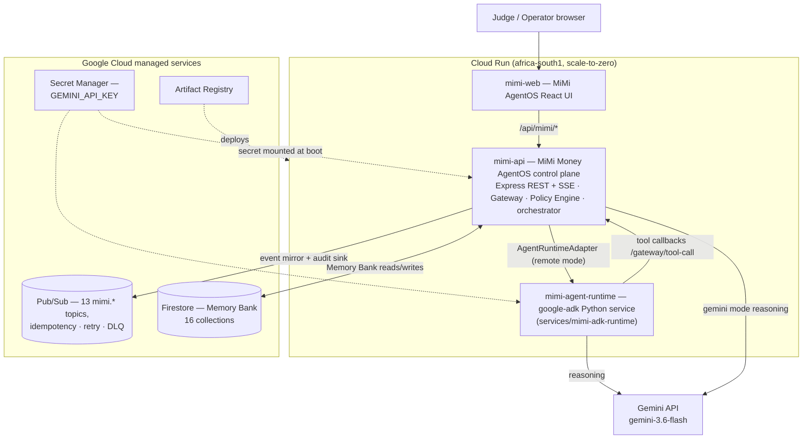

# MiMi AgentOS — Deployment Guide

Target architecture: **Cloud Run + Pub/Sub + Firestore + Gemini + ADK only.** No GKE, no Cloud SQL, no always-on services. Estimated cost for a hackathon: **$0–$2** (Cloud Run scale-to-zero + free tiers; Gemini flash-tier pennies).

---

## 1. Local development (zero cloud required)

```sh
pnpm install
pnpm dev            # http://localhost:3100
```

- Database: embedded PGlite/Postgres for the MiMi Money AgentOS control plane (implemented using the Paperclip framework).
- MiMi engine: in-process event transport + embedded Memory Bank + ADK local-simulation runtime.

### Optional: real Google APIs locally via emulators

```sh
./deploy/local-emulators.sh          # starts pubsub + firestore emulators via gcloud beta emulators
export PUBSUB_EMULATOR_HOST=localhost:8085
export FIRESTORE_EMULATOR_HOST=127.0.0.1:8080
export PUBSUB_PROJECT_ID=mimi-local FIRESTORE_PROJECT_ID=mimi-local
pnpm dev                             # System page now shows emulator modes; events/docs mirror into the emulators
```

### Optional: real Gemini

```sh
export MIMI_GEMINI_API_KEY=AIza...        # from https://aistudio.google.com/apikey
# optional tuning:
export MIMI_GEMINI_MISSION_MODEL=gemini-3.6-flash # mission-critical default
export MIMI_GEMINI_LIGHT_MODEL=gemini-3.5-flash   # lightweight default
export MIMI_ADK_MODE=google               # force gemini | local (default: auto-detect)
```

## 2. One-time GCP setup

```sh
export PROJECT_ID=your-project-id
gcloud config set project $PROJECT_ID

./deploy/setup-iam.sh          # service account with Cloud Run + Pub/Sub + Firestore + Secret Accessor roles
./deploy/setup-secrets.sh      # stores MIMI_GEMINI_API_KEY in Secret Manager
./deploy/setup-firestore.sh    # (optional) region hint; collections are created lazily by the app
./deploy/setup-pubsub.sh       # creates all 13 mimi.* topics (+ push subscription wiring notes)
```

## 3. Deploy to Cloud Run

```sh
./deploy/deploy-cloudrun.sh     # builds the repo Dockerfile and deploys --region africa-south1 (override REGION)
```

The script sets:
- `GOOGLE_CLOUD_PROJECT` → enables the production Pub/Sub REST publisher + Firestore REST Memory Bank,
- `MIMI_GEMINI_API_KEY` mounted from Secret Manager,
- min-instances 0 (scale-to-zero between demos), max-instances 2, CPU 1 / mem 512Mi,
- public unauthenticated ingress is NOT opened by default — keep Cloud Run IAM auth or your own SSO in front (MiMi's board auth still applies).

## 4. Environment variables reference

| Variable | Default | Purpose |
|---|---|---|
| `MIMI_GEMINI_API_KEY` | — | Enables real Gemini reasoning (falls back to local simulation) |
| `MIMI_GEMINI_MISSION_MODEL` | `gemini-3.6-flash` | Model for mission-critical financial work |
| `MIMI_GEMINI_LIGHT_MODEL` | `gemini-3.5-flash` | Model for lightweight support, reporting and escalation work |
| `MIMI_GEMINI_MODEL` | mission model alias | Backwards-compatible alias for `MIMI_GEMINI_MISSION_MODEL` |
| `MIMI_ADK_MODE` | auto | `google` \| `local` |
| `GOOGLE_CLOUD_PROJECT` | — | Switches backbone/Memory Bank to real GCP services |
| `PUBSUB_EMULATOR_HOST` / `PUBSUB_PROJECT_ID` | — | Emulator mode for Pub/Sub |
| `FIRESTORE_EMULATOR_HOST` / `FIRESTORE_PROJECT_ID` | — | Emulator mode for Firestore |
| `MIMI_CLOUD_RUN_REGION` | `africa-south1` | Displayed per-agent Cloud Run region |
| `MIMI_CLOUD_RUN_SERVICE_TEMPLATE` | `mimi-adk-{agent}` | Per-agent worker naming shown in the UI |

Secrets: locally env vars; on Cloud Run Secret Manager (`deploy/setup-secrets.sh`). Keys never reach prompts, memory documents, logs, or the browser.

## 5. Topology after deploy

### Deployment topology



ASCII summary:

```
Cloud Run (mimi-api)             ← control plane + orchestrator + Gateway (+ Gemini mode)
Cloud Run (mimi-web)             ← static UI
Cloud Run (mimi-agent-runtime)   ← real google-adk Python agents (optional; MIMI_ADK_RUNTIME_URL)
   ├─→ Pub/Sub  (mimi.payments, mimi.fraud, … 13 topics)   ← mirrored envelopes
   ├─→ Firestore ((default))                                ← Memory Bank collections
   └─→ Gemini API                                           ← reasoning/tool loops
Optional fleet isolation:
Cloud Run (mimi-adk-payment), (mimi-adk-fraud), …          ← same image, MIMI_AGENT_FILTER env
```

## 6. CI/test gates before shipping

```sh
pnpm -r typecheck          # workspace typecheck
pnpm test                  # vitest suite incl. packages/mimi + server mimi-routes E2E
pnpm check:token-gates     # design-token compliance for ui changes
```

## 7. Operational runbook

- **Recovery pass:** `POST /api/mimi/admin/recover` re-drives interrupted workflows from Firestore state.
- **Dead letters:** visible on System page; replay via bus API (`replayDeadLetter`) or fix + recover.
- **Budget reset:** Budgets page → Reset spend (also un-pauses hard-stopped agents).
- **Reset demo data:** local dev → stop server, delete instance data dir, restart (seeding is idempotent otherwise).
