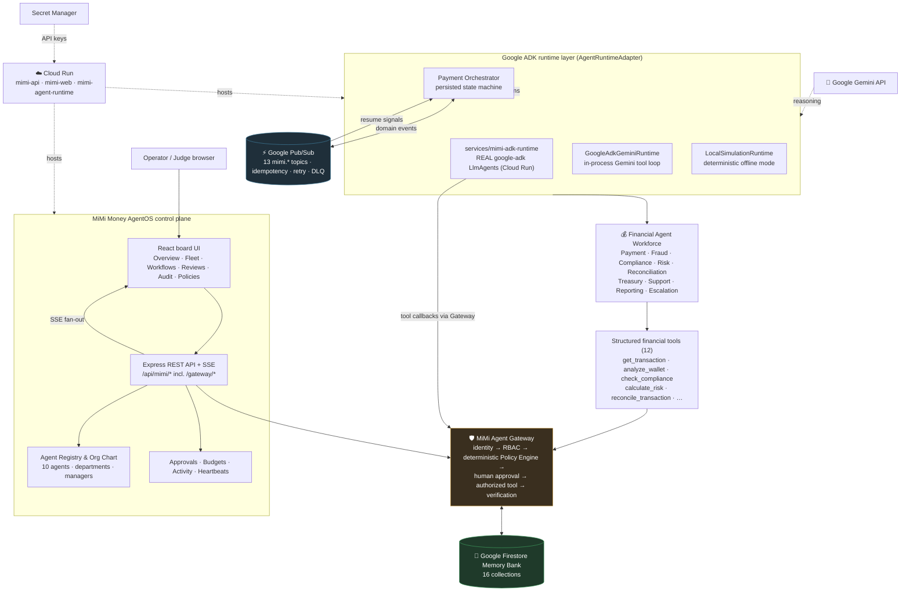
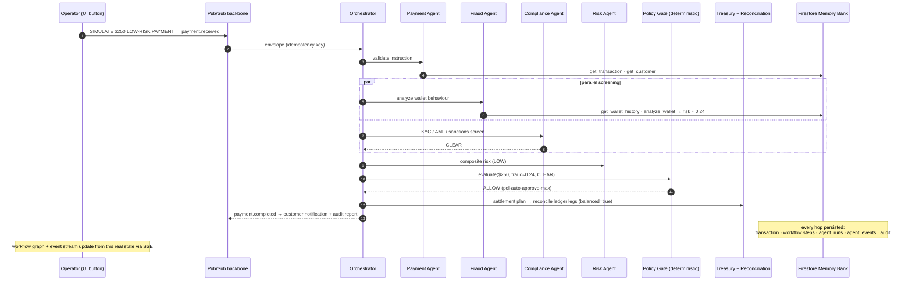
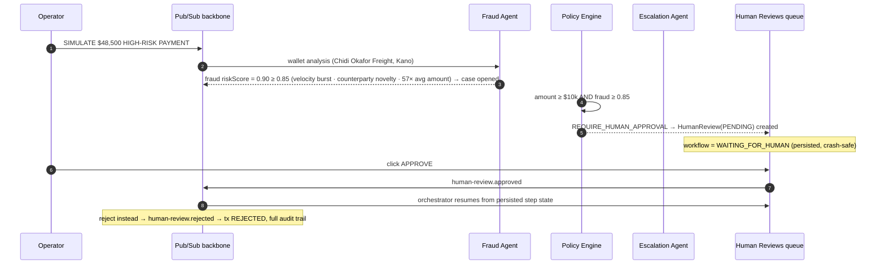

<p align="center">
  <a href="#-mimi-money-agentos"><strong>MiMi Money AgentOS</strong></a> ·
  <a href="#-features">Features</a> ·
  <a href="#-system-architecture">Architecture</a> ·
  <a href="#-data-flow">Data Flow</a> ·
  <a href="#-google-products-used">Google Stack</a> ·
  <a href="#-run-it-locally">Run Locally</a> ·
  <a href="#-deploy-to-google-cloud">Deploy</a> ·
  <a href="MIMI_AGENTOS_ARCHITECTURE.md">Architecture Doc</a> ·
  <a href="HACKATHON_SUBMISSION.md">Submission</a>
</p>

<br/>

# 🌍 MiMi Money AgentOS — African Financial AI Workforce

> **DEMO / SANDBOX MODE — every financial operation in this project is simulated. No real funds ever move.**

**An autonomous, governed AI workforce for African digital-finance operations.**

MiMi Money AgentOS supports both **Demo / Sandbox Mode** for deterministic,
zero-cost local runs and **production deployment** with Gemini, Google Cloud,
Firestore, Pub/Sub and Cloud Run API credentials. Production credentials enable
real model reasoning and managed infrastructure; they do **not** enable real
financial transfers. The banner above is a permanent safety guarantee for
both modes: every payment, settlement and ledger operation remains simulated.

MiMi AgentOS turns an enterprise AI-agent control plane into a **financial organization run by ten specialized AI agents**: they validate payments, hunt fraud, enforce KYC/AML compliance, price risk, plan settlement, reconcile ledgers, notify customers and write audit reports — and they know exactly when to **stop and ask a human**.

It is built as an extension of [Paperclip](https://github.com/paperclipai/paperclip) (MIT), which supplies the proven control plane — org charts for agents, approvals, budgets with hard stops, heartbeats, activity logging and governance. On top of that, **Google Gemini + Google ADK** provide the agent intelligence/runtime, **Pub/Sub** is the asynchronous nervous system, **Firestore** is the persistent Memory Bank, and **Cloud Run** is the deployment platform.

Built for the *Google All Things Agentic Hackathon* — **Fortified Enterprise Fleet** track.

---

## 🧭 The one-line mental model

| Layer | Technology | Role |
|---|---|---|
| 🏢 **Control plane** | **MiMi Money AgentOS** | Agent registry & org chart, approvals/human-in-the-loop, budgets, activity/audit visualization, operational dashboard; implemented on the Paperclip framework |
| 🧠 **Intelligence** | **Multimodal Google Gemini** (`gemini-3.6-flash` / `gemini-3.5-flash`) | Gemini 3.6 Flash for mission-critical financial work; Gemini 3.5 Flash for lightweight tasks, with text/image/audio/video understanding |
| 🤖 **Agent runtime** | **Google ADK** | Real `LlmAgent`s, sessions, runs, tool loops, pause/resume/cancel lifecycle |
| 🛡️ **Security gateway** | **MiMi Agent Gateway** | Identity → RBAC → deterministic Policy Engine → human approval → verified tools |
| ⚡ **Nervous system** | **Google Pub/Sub** | 13 topics, idempotency keys, retries, dead-letter queue |
| 🧬 **Memory Bank** | **Google Firestore** | Agents, customers, transactions, workflows, runs, events, policies, reviews, audit |
| ☁️ **Infrastructure** | **Cloud Run** | Scale-to-zero deployment of API, web UI and ADK runtime |

> **MiMi Money AgentOS = the company/control plane · Gemini + ADK = intelligence & runtime · Gateway = security/governance · Pub/Sub = the nervous system · Firestore = memory/state · Cloud Run = execution · MiMi agents = the autonomous workforce. Paperclip is the underlying framework only.**

---

## ✨ Features

### Financial AI workforce
- **10 specialized agents** organized into departments with real reporting lines:
  `Orchestrator` (Head of Payments Operations) → Payment · Fraud · Risk (team lead) · Compliance · Treasury → Reconciliation + Reporting · Customer Support · Human Escalation.
- Distinct **capabilities, permissions, allowed tools, memory scopes and budgets per agent** — Fraud can analyze wallets but can never move funds; Compliance can screen but can never override a mandatory human-approval rule.
- Full **runtime lifecycle** per agent (`IDLE · RUNNING · WAITING · PAUSED · FAILED · OFFLINE`) with pause / resume / inspect controls and budget hard-stop auto-pause.
- **Heartbeats**, health status, success rates and live current-task/workflow tracking per agent.

### Fortress-grade governance (the "fortified" part)
- **MiMi Agent Gateway** — the only path from any agent (or its LLM) to privileged capability:
  `identity → RBAC → deterministic policy → human approval (when required) → authorized tool → result verification → Pub/Sub event → persistence → audit record`.
- **Deterministic Policy Engine** outside the LLM — same inputs always produce the same decision:
  - `< $1,000 ∧ composite risk < 0.40 ∧ compliance CLEAR` → autonomous completion
  - `≥ $10,000` or `fraud risk ≥ 0.85` → mandatory human review (`WAITING_FOR_HUMAN`)
  - `fraud risk ≥ 0.97` → auto-decline; sanctions hit → immediate block
  - sandbox-only assets/networks allowlist, tool rate limits, budget hard-stops
- **Human Review queue** with approve/reject that resumes or closes the real backend workflow.
- Immutable-style **audit log** for every gateway decision, delegation, review and workflow milestone.
- HTTP **Gateway contract**: `POST /gateway/tool-call`, `/gateway/agent-call`, `/gateway/authorize`, `GET /gateway/policies`, `GET /gateway/permissions`.

### Real event-driven orchestration (no fake animations)
- **Pub/Sub-semantics event backbone** with idempotency keys (duplicate suppression), at-least-once delivery, exponential-backoff retries, handler timeouts and a dead-letter queue with replay.
- **Crash-safe payment state machine**: every transition persisted; startup recovery re-drives interrupted workflows from persisted state instead of restarting them.
- **Live SSE stream** pushes every real backend event to the UI in milliseconds.

### Operator command center (dark enterprise UI)
Overview command center · Agent Fleet org chart · Organization missions · Agent Inspector · Workflow orchestration graph (live node states) · Transactions ledger · Event stream explorer · Memory Bank inspector · Policy Center (live-editable in sandbox) · Human Reviews · Audit search · Budgets with hard-stop resets · System health panel.

### Multimodal Gemini model routing

MiMi Money AgentOS is multimodal across the Gemini and Google ADK runtimes:
agents can interpret relevant text, images, audio, and video supplied with a
task when those modalities are available. Model selection is policy-driven:

| Work class | Default model | MiMi agents / examples |
|---|---|---|
| Mission-critical | `gemini-3.6-flash` | Orchestrator, Payment, Fraud, Compliance, Risk, Treasury, Reconciliation; payments, policy gates, fraud/compliance decisions and settlement |
| Lightweight | `gemini-3.5-flash` | Customer Support, Reporting, Human Escalation; notifications, summaries and operator briefings |

Override the defaults with `MIMI_GEMINI_MISSION_MODEL` and
`MIMI_GEMINI_LIGHT_MODEL`. `MIMI_GEMINI_MODEL` remains a backwards-compatible
alias for the mission-critical model. Every model call remains behind the MiMi
Agent Gateway, and no model receives authority to bypass policy or move funds.

### Three interchangeable runtimes behind one adapter
| Adapter | Mode | Use |
|---|---|---|
| `GoogleAdkRemoteRuntime` | **real google-adk Python service** | production / judge demos with Cloud Run |
| `GoogleAdkGeminiRuntime` | Gemini function-calling loop in-process | single-container deployments |
| `GoogleAdkLocalSimulationRuntime` | deterministic local execution | zero-cost local dev, CI, offline demos |

All three execute the same runs/sessions/tool-loop lifecycle, route privileged calls through the Gateway, and never persist chain-of-thought.

---

## 🏗️ System architecture



The bidirectional relationship at the heart of the design:

```
MiMi Money AgentOS (control plane)  ↔  Google ADK Runtime (intelligence + execution)
        registry · goals · approvals · budgets · audit   ↔   sessions · runs · tools · reasoning
```

---

## 🔁 Data flow

### Autonomous flow — `$250 USDC low-risk payment`



### Human-in-the-loop flow — `$48,500 USDC high-risk payment`



Every event envelope carries `{eventId, type, topic, workflowId, correlationId, idempotencyKey, sourceAgent, targetAgent, payload, attempt}`.

---

## 🛠️ How it was built

1. **Forked the architecture, not just the brand.** Paperclip's Express server, React board, org-chart/approval/budget/activity/heartbeat systems were preserved intact and extended with a financial domain module instead of being replaced. Upstream MIT license and attribution retained.
2. **`packages/mimi` (`@mimi/agentos-core`) — the engine.** A framework-free TypeScript package implementing the whole domain: agent catalog & org chart (10 agents, departments, reporting lines), the deterministic Policy Engine, the MiMi Agent Gateway, a Pub/Sub-semantics event bus (idempotency keys, exponential-backoff retries, dead-letter queue, + emulator/production REST mirror), a Firestore-shaped Memory Bank (+ Firestore REST client), 12 structured financial tools, the crash-safe persisted-state payment orchestrator, and realistic African-market seed data.
3. **Three interchangeable runtimes behind one `AgentRuntimeAdapter` contract** (create/start/inspect/pause/resume/cancel runs, session event logs, tool loops): `GoogleAdkGeminiRuntime` (in-process Gemini function calling), `GoogleAdkLocalSimulationRuntime` (deterministic offline mode), and `GoogleAdkRemoteRuntime` (delegates to the Python service below). Tool calls in every mode are routed through the Gateway; chain-of-thought is never persisted.
4. **`services/mimi-adk-runtime` — the workforce as *real* Google ADK Python agents** (`google.adk.agents.LlmAgent` + Gemini function calling, FastAPI `/healthz` + `/runs`). Its tools call privileged capability **back through** the Gateway HTTP surface, so identity/RBAC/policy/audit enforcement is identical no matter where reasoning happens.
5. **Server + UI integration.** The MiMi router mounts under `/api/mimi` inside the existing Paperclip app (board-operator context, milestones mirrored into Paperclip's activity log); the board UI gained 13 MiMi pages composed from the existing component system with a token-gated dark enterprise theme, updating live over SSE from real backend events.
6. **Verification-first engineering.** 46 core tests (policy bands, gateway RBAC/rate-limit/budget denials, event-bus idempotency/retries/DLQ, crash recovery, retry-then-complete, no-CoT-persistence), 7 server E2E route tests over the full HTTP surface, Python unit tests for the ADK service, full workspace typecheck + production build + design-token gates — and both demo flows validated end-to-end over live HTTP (16/16 Definition-of-Done checks) before hand-off.

---

## 🧰 Google products used and their functions

| Product | Function in MiMi AgentOS |
|---|---|
| **Multimodal Gemini** (`gemini-3.6-flash` + `gemini-3.5-flash`) | Mission-critical and lightweight reasoning inside ADK agents; text/image/audio/video understanding when supplied, function calling for tool selection, temperature 0.2, no chain-of-thought persisted |
| **Google ADK** (`google-adk`) | The agent framework: `LlmAgent`s with identity/instructions/tools, runners, session management, run lifecycle (create/start/pause/resume/cancel/inspect) |
| **Pub/Sub** | Asynchronous event backbone: 13 `mimi.*` topics carrying every domain event; idempotency keys suppress duplicates; retries with backoff; dead-letter topics; emulator support locally |
| **Firestore** | The Memory Bank and all workflow/agent state: 16 collections (`agents`, `customers`, `transactions`, `workflows`, `workflow_steps`, `agent_runs`, `agent_events`, `policies`, `human_reviews`, `audit`, …); REST client works against prod or the emulator |
| **Cloud Run** | Hosts everything scale-to-zero: `mimi-api` (control plane + orchestrator), `mimi-web` (UI), `mimi-agent-runtime` (ADK Python service); optional per-agent services (`mimi-adk-{agent}` template) |
| **Secret Manager** | Holds `MIMI_GEMINI_API_KEY` / `GOOGLE_API_KEY`; mounted at boot, never in source |
| **Artifact Registry + Cloud Build** | Container builds for the deploy pipeline |
| **Cloud Logging / Monitoring** | Structured request logs and health probes on Cloud Run services |
| **Pub/Sub & Firestore emulators** | Full local parity with production Google APIs during development (`deploy/local-emulators.sh`) |

---

## 💻 Tech stack

| Area | Technology |
|---|---|
| Control plane server | Node.js ≥ 24.11, TypeScript 5.7, Express |
| Core engine | Framework-free TypeScript (`@mimi/agentos-core`) |
| Agent runtime | Python ≥ 3.11, `google-adk`, FastAPI, uvicorn, httpx, pydantic |
| Frontend | React 19, Vite, Tailwind v4 (token-gated design system), TanStack Query, lucide icons |
| Data | Drizzle ORM + embedded PostgreSQL (upstream Paperclip control-plane data) + Firestore-shaped Memory Bank (embedded store / emulator / production) |
| Events | In-process Pub/Sub-semantics bus with mirror to Google Pub/Sub REST (emulator or prod) |
| Tests | Vitest (46 core + 7 server E2E), pytest for the ADK service, Playwright suites inherited from upstream |
| Infra | Docker, gcloud CLI scripts, Cloud Run, Secret Manager |

---

## 📂 Repository map

```
packages/mimi/                @mimi/agentos-core — the MiMi engine
  src/types.ts                  domain types (agents, workflows, events, policies…)
  src/constants.ts              agent catalog, org chart, default policies, topics
  src/policy-engine.ts          deterministic rules engine
  src/gateway.ts                MiMi Agent Gateway (identity→RBAC→policy→approval→verify→audit)
  src/event-bus.ts              Pub/Sub-semantics backbone (idempotency, retries, DLQ)
  src/google-pubsub-rest.ts     emulator/production Pub/Sub mirror
  src/memory-bank.ts            embedded Memory Bank (dev/tests)
  src/firestore-rest.ts         Firestore REST Memory Bank (emulator/prod)
  src/tools.ts                  12 structured financial tools
  src/adk-gemini-runtime.ts     Gemini-backed ADK runner
  src/adk-local-runtime.ts      deterministic offline runner
  src/adk-remote-runtime.ts     remote google-adk Python service adapter
  src/orchestrator.ts           persisted-state payment workflow machine
  src/seed.ts                   African-market sandbox data (customers, wallets, policies…)
  src/service.ts                wiring + UI read models
services/mimi-adk-runtime/    REAL Google ADK (Python) agent runtime
  mimi_adk/agents.py            10-agent workforce as LlmAgents
  mimi_adk/tools.py             financial tools as ADK function tools (Gateway-backed)
  mimi_adk/gateway.py           callback client to MiMi Agent Gateway
  mimi_adk/service.py           FastAPI /healthz + /runs
server/src/routes/mimi*.ts    HTTP/SSE surface incl. /gateway/* contract + activity mirror
ui/src/pages/mimi/*           Overview, Fleet, Organization, Agents, Workflows,
                              Transactions, Events, Memory Bank, Policies,
                              Human Reviews, Audit, Budgets, System
deploy/*.sh                   Cloud Run / Pub/Sub / Firestore / IAM / secrets / emulators
MIMI_AGENTOS_*.md             architecture, security, demo script, deployment docs
HACKATHON_SUBMISSION.md       problem/solution/demo story
```

---

## ▶️ Run it locally

### Prerequisites
- Node.js **24.11+** and pnpm **9.15.4**
- *(optional)* a free [AI Studio API key](https://aistudio.google.com/apikey) for real Gemini reasoning
- *(optional)* [`gcloud` CLI](https://cloud.google.com/sdk) for emulators/deployment

### Step-by-step quickstart (zero configuration, zero cost)

These steps run the complete MiMi Money AgentOS Demo / Sandbox Mode locally. No Docker, PostgreSQL,
Firestore project, Pub/Sub project, or Gemini key is required.

1. Install Node.js 24.11 or newer and pnpm 9.15.4. Confirm both versions:

   ```bash
   node --version   # v24.11.0 or newer
   pnpm --version   # 9.15.4
   ```

2. Clone the repository and enter it:

   ```bash
   git clone https://github.com/mimimoneydev/MiMi-Money-AgentOS.git MiMi-Money-AgentOS
   cd MiMi-Money-AgentOS
   ```

   If you are using a fork or a downloaded archive, use that repository’s
   checkout instead; the remaining commands are unchanged.

3. Install the locked JavaScript dependencies:

   ```bash
   corepack enable
   pnpm install --frozen-lockfile
   ```

4. Bootstrap the local MiMi Money AgentOS instance. The default is `local_trusted`
   mode, which binds the server to your computer only and uses embedded
   PostgreSQL/PGlite automatically:

   ```bash
   pnpm paperclipai onboard --yes
   ```

   This creates the local instance configuration with the trusted loopback
   defaults and starts the server; it does not contact Google Cloud or move
   real money.

5. Leave the onboarding terminal running. In a second terminal, verify that
   the API is ready:

   ```bash
   curl http://localhost:3100/api/health
   ```

   A healthy server returns `{"status":"ok"}`. If port 3100 is already in
   use, stop the other MiMi Money AgentOS process with `pnpm dev:stop` and start again.

6. Open **http://localhost:3100** in a browser. The default `local_trusted`
   mode requires no login because the server is bound to loopback only. Open
   the **MiMi Money AgentOS** section; the persistent `DEMO · SANDBOX` banner confirms
   that all financial operations are simulated.

The default local run uses the deterministic ADK local-simulation runtime. It
therefore works offline and produces the same Gateway, Policy Engine, event,
persistence, and workflow-state behavior every time.

To stop the server, press `Ctrl-C` in the terminal running `pnpm dev`. To start
over with a fresh local instance, stop the server and remove the instance data
using the reset instructions in [`docs/deploy/local-development.md`](docs/deploy/local-development.md).

### The two demo buttons

On **Overview** (`/mimi`):
1. **SIMULATE $250 LOW-RISK PAYMENT** → watch the workflow graph light up from real persisted state; completes autonomously in seconds.
2. **SIMULATE $48,500 HIGH-RISK PAYMENT** → Fraud Agent scores 0.90 → Policy Engine halts (`WAITING_FOR_HUMAN`) → sidebar badge counts up → open **Human Reviews**, inspect evidence, press **Approve & resume** → the exact same workflow resumes from persisted state and settles.

Then explore: **Events** (every envelope with correlation + idempotency IDs) · **Memory Bank** (browse what was persisted) · **Audit** (every gateway decision) · **Policies** (toggle a rule live and trigger another payment).

### Optional: real Gemini reasoning

```bash
cp .env.example .env       # then set:
# MIMI_GEMINI_API_KEY=...            → enables multimodal Gemini reasoning
# MIMI_GEMINI_MISSION_MODEL=gemini-3.6-flash → mission-critical financial work
# MIMI_GEMINI_LIGHT_MODEL=gemini-3.5-flash   → lightweight support/reporting work
# MIMI_ADK_MODE=google|local|remote  → force a runtime mode
pnpm dev
```

### Optional: full Google API parity with emulators

```bash
./deploy/local-emulators.sh
# in another shell:
export PUBSUB_EMULATOR_HOST=localhost:8085 FIRESTORE_EMULATOR_HOST=127.0.0.1:8080
export PUBSUB_PROJECT_ID=mimi-local FIRESTORE_PROJECT_ID=mimi-local
pnpm dev
```
The **System** page now reports `google-pubsub-emulator` + `firestore-emulator`; every event/document is mirrored through real Google APIs locally.

### Optional: run the real google-adk Python runtime

```bash
cd services/mimi-adk-runtime
python -m venv .venv && source .venv/bin/activate
pip install -e ".[dev]"
export GOOGLE_API_KEY=...
uvicorn mimi_adk.service:app --port 9700 &
cd ../..
MIMI_ADK_RUNTIME_URL=http://localhost:9700 pnpm dev
```

### Tests

```bash
pnpm test                                   # whole workspace (Vitest)
cd packages/mimi && vitest run              # core engine suite (46 tests)
cd server && vitest run src/__tests__/mimi-routes.test.ts   # HTTP E2E (7 tests)
cd services/mimi-adk-runtime && python -m pytest   # ADK service unit tests
pnpm check:token-gates                      # UI design-token compliance
```

---

## ☁️ Deploy to Google Cloud

The following is a reproducible production spin-up for a new Google Cloud
project. It provisions the managed services, builds the exact checked-out
commit, deploys the control plane and real Google ADK runtime to Cloud Run,
then verifies the deployment. The application is a **simulation**: it has no
real-money rails.

### Prerequisites

- A Google Cloud account with an active billing account and permission to
  create projects, IAM service accounts, secrets, Firestore, Pub/Sub, Cloud
  Build, and Cloud Run resources.
- [`gcloud` CLI](https://cloud.google.com/sdk/docs/install) authenticated with
  an account that can administer the target project.
- A Gemini API key from [Google AI Studio](https://aistudio.google.com/apikey).

### Step-by-step production deployment

> **Live financial execution requires an external payment integration.** The
> current MiMi Money AgentOS demo workflows remain simulated until a live rail
> is deliberately configured and implemented. Before enabling live production
> execution, provide:
>
> - The intended payment rail/provider and its API contract, for example
>   Circle, Stripe, Flutterwave, M-Pesa, a bank API, or a blockchain
>   RPC/wallet provider.
> - Production credentials and the Secret Manager secret names that hold them.
> - Supported currencies and networks.
> - Approval, compliance, transaction-signing, and rollback requirements.
>
> The required configuration placeholders are listed in [`.env.example`](.env.example).
> Do not put production credentials directly in `.env`; use Secret Manager in
> Cloud Run. Until the external rail is connected, production deployment means
> production hosting and Gemini/GCP execution with simulated financial data.

1. Clone this repository at the commit you want to deploy, then enter it:

   ```bash
   git clone https://github.com/mimimoneydev/MiMi-Money-AgentOS.git MiMi-Money-AgentOS
   cd MiMi-Money-AgentOS
   ```

2. Set the project, region, and Gemini key. Use an existing project or create
   one in the Cloud Console first; `gcloud services enable` does not create a
   project or billing account:

   ```bash
   export PROJECT_ID="your-gcp-project-id"
   export REGION="africa-south1"
   export MIMI_GEMINI_API_KEY="your-gemini-api-key"

   gcloud auth login
   gcloud config set project "$PROJECT_ID"
   gcloud services enable \
     run.googleapis.com cloudbuild.googleapis.com artifactregistry.googleapis.com \
     pubsub.googleapis.com firestore.googleapis.com secretmanager.googleapis.com
   ```

3. Provision the service account, Gemini secret, Firestore database, and all
   MiMi Pub/Sub topics. These commands are idempotent and can be rerun safely:

   ```bash
   PROJECT_ID="$PROJECT_ID" ./deploy/setup-iam.sh
   PROJECT_ID="$PROJECT_ID" MIMI_GEMINI_API_KEY="$MIMI_GEMINI_API_KEY" ./deploy/setup-secrets.sh
   PROJECT_ID="$PROJECT_ID" REGION="$REGION" ./deploy/setup-firestore.sh
   PROJECT_ID="$PROJECT_ID" REGION="$REGION" ./deploy/setup-pubsub.sh
   ```

4. Build and deploy the checked-out commit. The script uses the repository root
   regardless of the directory from which it is called, and deploys the same
   immutable image tag that Cloud Build produced:

   ```bash
   PROJECT_ID="$PROJECT_ID" REGION="$REGION" ./deploy/deploy-cloudrun.sh
   ```

   By default this creates `mimi-agentos` and `mimi-agent-runtime`. To deploy
   only the control plane and use the deterministic in-process runtime, set
   `SKIP_ADK_RUNTIME=1`.

5. If the ADK runtime was deployed, wire its Cloud Run URL into the control
   plane using the URL printed by the deploy script:

   ```bash
   export ADK_URL="https://mimi-agent-runtime-<hash>-<region>.run.app"
   gcloud run services update mimi-agentos \
     --region "$REGION" \
     --update-env-vars "MIMI_ADK_RUNTIME_URL=$ADK_URL"
   ```

6. Verify the service and open the returned URL:

   ```bash
   export APP_URL="$(gcloud run services describe mimi-agentos \
     --region "$REGION" --format='value(status.url)')"
   curl --fail "$APP_URL/api/health"
   echo "$APP_URL"
   ```

   Open `APP_URL` in a browser, enter the MiMi Money AgentOS section, and run both
   demo payments. The `$250` flow should complete autonomously; the `$48,500`
   flow should enter Human Reviews and resume after approval.

Cloud Run is configured for scale-to-zero and the deployment helper currently
allows unauthenticated ingress so a judge can reach the MiMi Money AgentOS login screen;
MiMi Money AgentOS authentication still applies. For a private production deployment,
remove `--allow-unauthenticated` from `deploy/deploy-cloudrun.sh` and put the
service behind IAM, IAP, or an organization SSO/VPN boundary.

For operational details, environment variables, recovery, backups, and the
Cloud Run topology, see [`MIMI_AGENTOS_DEPLOYMENT.md`](MIMI_AGENTOS_DEPLOYMENT.md).

### One-command reference

```bash
# Provision IAM, secrets, Firestore and Pub/Sub (run each once)
./deploy/setup-iam.sh
./deploy/setup-secrets.sh
./deploy/setup-firestore.sh
./deploy/setup-pubsub.sh

# Build containers and deploy to Cloud Run (including the ADK runtime)
PROJECT_ID=your-project ./deploy/deploy-cloudrun.sh
```

The short form above assumes that `gcloud` is already authenticated, the
project is selected, required APIs are enabled, and `MIMI_GEMINI_API_KEY` is
available in the environment or entered interactively.

---

## 🔐 Security model (summary)

- Agent identity + least-privilege RBAC per tool; unknown identities denied outright.
- Deterministic Policy Engine **always wins** over LLM-generated actions.
- Mandatory human approval above $10k or fraud ≥ 0.85; auto-decline at ≥ 0.97; sanctions blocks.
- Sandbox guard: only testnet assets/networks are reachable; **no real-money rails exist in code**.
- Rate limiting per agent/tool, budget hard-stops that pause runaway agents.
- Idempotency everywhere; immutable-style audit records for decisions, executions, denials and approvals.
- Secrets only via env vars locally / Secret Manager in production — never in source.

Details: [`MIMI_AGENTOS_SECURITY.md`](MIMI_AGENTOS_SECURITY.md).

---

## 📚 More documentation

| Doc | Contents |
|---|---|
| [`MIMI_AGENTOS_ARCHITECTURE.md`](MIMI_AGENTOS_ARCHITECTURE.md) | Deep architecture, gateway pipeline, policy tables, all six diagrams |
| [`MIMI_AGENTOS_SECURITY.md`](MIMI_AGENTOS_SECURITY.md) | Threat model and controls |
| [`MIMI_AGENTOS_DEMO.md`](MIMI_AGENTOS_DEMO.md) | Four-minute judge walkthrough |
| [`MIMI_AGENTOS_DEPLOYMENT.md`](MIMI_AGENTOS_DEPLOYMENT.md) | Cloud Run / Pub/Sub / Firestore operations |
| [`HACKATHON_SUBMISSION.md`](HACKATHON_SUBMISSION.md) | Problem, solution, why African fintech, demo story |
| [`AGENTS.md`](AGENTS.md), [`doc/DEVELOPING.md`](doc/DEVELOPING.md) | Upstream contribution & development guides |

---

## 🙏 Attribution & license

This project is an extension of **[Paperclip](https://github.com/paperclipai/paperclip)** — *"If OpenClaw is an employee, Paperclip is the company"* — used here as the enterprise agent-management control plane. Paperclip's architecture, upstream MIT license and attribution are preserved; MiMi adds the financial domain, Google ADK/Gemini runtime integration and the governed-workforce experience on top. No proprietary Paperclip branding or assets are copied.

```text
MIT License

Copyright (c) 2025 Paperclip AI        # upstream control plane
Copyright (c) 2026 MiMi AgentOS contributors   # this extension
```

See [`LICENSE`](LICENSE) for the full license text.

---

<p align="center">
  <sub><strong>MiMi Money AgentOS</strong> — an autonomous, governed AI workforce for African digital-finance operations.<br/>
  SANDBOX ONLY · no real funds move · built with Gemini + Google ADK + Pub/Sub + Firestore + Cloud Run as MiMi Money AgentOS, implemented on the Paperclip framework.</sub>
</p>
